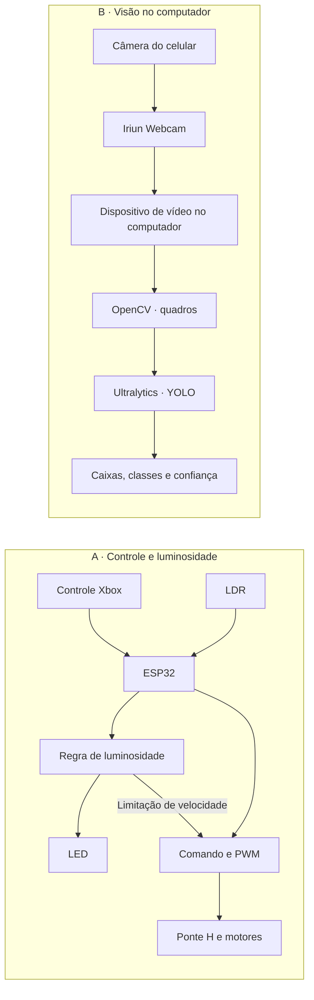

# ROTA LIVRE — Robô Inteligente para Monitoramento Ambiental e Identificação de Objetos

**FIAP · Engenharia de Software — 4ES · Global Solution CitizenTech 2026.2**

**Project-Based Maker Lab · Victoria Franceschini Pizza · RM 550609**

[Visão geral da entrega GS](GS/README.md) · [Checkpoints](CP/README.md) · [Validação](#testes-e-validação) · [Vídeo](#vídeo-demonstrativo)

## Resumo

O ROTA LIVRE é um carrinho robótico para observar condições ambientais e objetos em um percurso experimental. Na configuração final informada pela aluna, um controle Xbox comanda a tração do carrinho, um sensor LDR informa a luminosidade ao ESP32 e uma regra de firmware acende um LED e reduz a velocidade em pouca luz. Paralelamente, a câmera de um celular junto ao carrinho transmite vídeo ao computador, onde OpenCV e Ultralytics compõem o fluxo de detecção visual. A IA desta configuração atua sobre os quadros da câmera.

O material disponível confirma partes desse percurso em versões distintas. Um pacote histórico usa Bluepad32, entrada analógica e PWM. Um sketch experimental da GS lê um LDR, e os scripts de visão do repositório executam inferência Ultralytics com um YOLOv8n de uma classe. O firmware final com LED e regra de luminosidade e o peso generalista de 80 classes não foram localizados. Por isso, valores do firmware histórico, classes e testes são atribuídos à revisão em que aparecem.

## Introdução

A qualidade da iluminação afeta a percepção de desníveis, objetos e pessoas em espaços de circulação. Em um cenário de bancada, variar a luz e observar a resposta do veículo ajuda a estudar como sistemas embarcados podem adaptar seu comportamento. Uma câmera móvel acrescenta informação visual ao contexto, permitindo investigar o que aparece no campo de visão do protótipo. A execução da visão em um computador separa a carga de inferência das tarefas locais de leitura e atuação do ESP32.

## Problema e justificativa

Em áreas pouco iluminadas, obstáculos podem ser percebidos mais tarde e dificultar o deslocamento. A proposta reúne um sinal local de pouca luz e uma interface visual que pode apoiar inspeções experimentais. O LDR indica variações relativas do circuito. A câmera permite estudar classes visuais, mas a posição de uma caixa na imagem, por si só, não informa se um objeto ocupa a faixa útil de passagem. O projeto não demonstrou redução de acidentes ou operação em vias públicas.

## Objetivo geral

Investigar a combinação de controle manual, resposta à iluminação e detecção de objetos em uma plataforma móvel para monitoramento ambiental.

## Objetivos específicos

- Evoluir a base robótica preservando o histórico do CP1, do CP2 e do CP2-TinyML.
- Receber comandos de direção do controle Xbox e adaptar a saída dos motores quando o ambiente escurecer.
- Sinalizar pouca luz por LED e verificar a transição de volta à condição iluminada.
- Usar o celular como câmera do computador e exibir detecções, rótulos e confiança.
- Registrar as dependências, a montagem, os casos de falha e as evidências de cada versão.

## Contextualização CitizenTech

A combinação de observação visual e indicação de iluminação é relevante para estudos de mobilidade e segurança em calçadas, corredores e áreas de circulação. Um uso futuro poderia apoiar a triagem de pontos que mereçam inspeção. Essa finalidade exige ensaios representativos, critérios para definir obstruções e evidência das condições observadas. [FIAP — CitizenTech](https://experience.fiap.com.br/global-solution-citizen-tech)

## Visão geral da solução

| Parte | Configuração final informada | Evidência auditada |
|---|---|---|
| Tração | Controle Xbox → ESP32 → ponte H → motores | Bluepad32 e dois canais de PWM em um ZIP histórico do CP2. O sketch definitivo ainda não está no workspace. |
| Ambiente | LDR → regra de pouca luz → LED e redução de velocidade | A GS anterior possui sketch de leitura com LDR. O ZIP histórico possui redução por TinyML com entrada analógica. A regra final de LED/PWM não foi localizada. |
| Visão | Celular junto ao carrinho → Iriun Webcam → OpenCV/Ultralytics no computador | Instalador Iriun identificado. Scripts de captura e detecção localizados. Montagem óptica, execução conjunta e peso generalista ainda sem comprovação. |

## Arquitetura do sistema

O diagrama representa a configuração final **informada**. Ele indica as responsabilidades dos módulos. A tabela acima identifica a evidência disponível para cada caminho.



A integração operacional é observar visualmente o ambiente enquanto o carrinho responde a comandos e à luminosidade. Nos scripts auditados, as saídas visuais são exibidas em uma janela local. Não foi localizada interface que envie classes, coordenadas ou ordens do computador para os motores.

## Hardware e componentes

| Componente | Função | Identificação |
|---|---|---|
| ESP32 | Controle embarcado, ADC e comando de tração | Família confirmada nas fontes. Variante da placa definitiva a confirmar. |
| Controle Xbox | Entrada manual de movimento | Informado pela aluna. Modelo e versão de firmware do controle não verificados. |
| LDR | Sensor de luminosidade relativa | Informado na montagem final e previsto no sketch experimental. Modelo e circuito reais a confirmar. |
| LED | Indicação local de pouca luz | Informado pela aluna. GPIO, polaridade e corrente de acionamento ainda não documentados. |
| Ponte H e motores DC | Comutação de sentido e ajuste por PWM | O CP1 documenta quatro motores e duas pontes. O pacote externo do CP2 usa dois canais. Modelo, quantidade e ligação do conjunto final ainda a confirmar. |
| Celular e computador Windows | Captura de vídeo e inferência | Celular junto ao carrinho conforme o relato. Modelo, fixação e conexão em uso não verificados. |

## Pinagem e conexões

A tabela registra **pinos de fontes identificadas**. Use a pinagem da sua revisão ao montar ou gravar o carrinho.

| Fonte | Entrada analógica | PWM / IN1 / IN2 | LED |
|---|---|---|---|
| [CP1 versionado](main.ino) | Joystick X/Y 34/35 no ESP32 separado do controle | DD 25/26/27, DE 13/12/14, TD 15/2/4, TE 18/19/21 | Sem LED de luminosidade identificado |
| CP2 CarrinhoLuz, ZIP local, `firmware/carrinho_integrado/carrinho_integrado.ino` | Sensor analógico 39, sem identificação física no pacote | Esquerda 19/18/5, direita 15/4/2 | Sem acionamento de LED no sketch |
| [Experimento LDR da GS](GS/firmware/ldr_monitor/ldr_monitor.ino) | GPIO34, ADC de 12 bits, atenuação de 11 dB | Sem tração | Sem acionamento de LED |
| Configuração final Xbox + LDR + LED | GPIO e polaridade do circuito a confirmar | Pinagem, frequência e modelo da ponte a confirmar | GPIO e nível ativo a confirmar |

## Sensor LDR e resposta automática

Um LDR altera sua resistência com a luz incidente. Em um divisor de tensão, essa variação chega ao ADC como um nível analógico. A posição do sensor no circuito determina se o código ADC cresce ou cai quando a luz diminui. Leituras brutas não são iluminância em lux.

O comportamento informado para a entrega é acender o LED e limitar a velocidade em pouca luz, mantendo a direção solicitada pelo operador. Ao voltar à luz adequada, o firmware deve restaurar o estado de saída previsto. O limiar, a comparação usada, a existência de histerese, o nível do LED, a intensidade da redução e a restauração automática dependem do sketch definitivo. Nenhum desses valores foi inferido a partir de revisões antigas.

Essa resposta local é **automação condicional** quando implementada por `if/else`. A IA visual é a inferência YOLO executada no computador.

O sketch experimental `ldr_monitor.ino` inicializa serial a 115200, lê cinco amostras e emite a mediana a cada 200 ms em regime nominal. Gera `LDR,tempo_ms,adc,status` e marca os extremos 0 e 4095 como limite ou inválido. Ele só serve para aquisição. O programa de centroides que consome esses dados pertence ao experimento anterior.

## Controle Xbox e movimentação

O ZIP histórico `CP2_CarrinhoLuz_Entrega_Com_Video.zip` contém um sketch `carrinho_integrado.ino` com `Arduino.h`, `Bluepad32.h` e `CarrinhoLuz_inferencing.h`. Ele configura callbacks Bluetooth com `BP32.setup`. No laço, `BP32.update()` alimenta `processControllers()`, que verifica conexão e novos dados.

| Bloco do sketch histórico | Comportamento confirmado |
|---|---|
| `processControllers()` | Interpreta Y para frente, A para ré, X para esquerda e B para direita, conforme código e comentários. Comando base de magnitude 200. |
| `moverEsquerdo()` / `moverDireito()` | Saturam o comando em ±255. O sinal define as entradas IN e o módulo define o duty do PWM a 5 kHz, 8 bits. |
| `aplicarMotores()` | Zera ambos os comandos após mais de 400 ms sem dados válidos. O callback de desconexão zera os comandos base. |
| `taskIA()` | Converte ADC 0–4095 para 0–1023 e executa a interface Edge Impulse. Uma saída `reduzir` com confiança mínima 0,70 aplica fator 0,60. Falha ou confiança baixa também mantém a redução. |
| Compatibilidade LEDC | Usa o pino PWM para `ledcWrite` no core 3.x e o canal PWM no ramo anterior. |

O ZIP é uma referência histórica para a evolução do controle. O fator 0,60, o limiar de confiança e os botões acima descrevem **esse sketch**, que usa TinyML para reduzir a velocidade. A confirmação da comunicação, dos eixos ou botões, do retorno à velocidade normal e do estado seguro no firmware final exige acesso ao código de entrega e ensaio físico. [Bluepad32 — controles compatíveis](https://bluepad32.readthedocs.io/en/latest/supported_gamepads/)

## Sistema de câmera com celular

O nome correto é **Iriun Webcam**. A identificação se baseia no instalador local `IriunWebcam-2.9.9.exe` e no nome publicado pelo fornecedor. Isso identifica a ferramenta, mas a versão efetivamente instalada e o índice da câmera no ensaio não foram verificados.

Conforme o relato, o celular é posicionado junto ao carrinho para enquadrar a frente. O aplicativo transmite os quadros ao cliente do computador pelo mecanismo de conexão usado na montagem. O cliente disponibiliza um dispositivo de vídeo. OpenCV abre esse dispositivo por índice com `VideoCapture`. Ultralytics processa os quadros no computador. [Iriun Webcam — aplicativo e cliente](https://iriun.com/)

## Visão computacional e modelo YOLO

A detecção de objetos associa caixas delimitadoras, rótulos e escores a regiões de um quadro. O OpenCV captura e exibe os quadros. Ultralytics carrega os pesos treinados, aplica o pré-processamento da biblioteca, executa a inferência e fornece os resultados. O peso carregado define quais classes podem ser previstas.

| Artefato | Modelo e classes verificadas | Uso |
|---|---|---|
| [`GlobalSolution/best.pt`](GlobalSolution/best.pt) e cópia em `Teste.zip` | YOLOv8n, `0 — bolinha de papel`. A cópia tem o mesmo SHA-256. | Chamado por `mach1.py`, `mach2.py` e `mach6.py`. |
| Outro `best.pt` em Downloads | Checkpoint YOLOv8n diferente, também com `0 — bolinha de papel`. | Sem vínculo comprovado com o script final. |
| Detector generalista informado | Peso e arquitetura não localizados. | As 80 classes de COCO são plausíveis para um peso treinado nesse dataset, mas não foram confirmadas para a entrega. |

Pessoas, cães, gatos, garrafas, copos, cadeiras, carros e bicicletas são exemplos de classes de [COCO](https://docs.ultralytics.com/datasets/detect/coco). Os checkpoints inspecionados não incluem essas classes nem classes específicas de cor, lixo ou embalagens de suco. Confirme o campo `names` do peso efetivamente carregado antes de descrever essas capacidades.

No [mach2.py](GlobalSolution/mach2.py), `main()` carrega `best.pt`, abre o índice 0 e solicita 640 × 480 à câmera. Em cada iteração, `cap.read()` entrega um quadro. As linhas a seguir são do script:

```python
results = model(frame, conf=0.5, verbose=False)
annotated_frame = results[0].plot()
```

O limiar de 0,50 pertence a esse script. Um escore alto indica que o detector favoreceu uma classe em determinada região, sem garantir que a detecção esteja correta. `plot()` sobrepõe caixas e rótulos ao quadro. O [mach1.py](GlobalSolution/mach1.py) abre o índice 1 e usa 0,60. O [mach6.py](GlobalSolution/mach6.py) seleciona regiões por movimento e desenha caixas com `box.xyxy`, `box.cls` e `box.conf`. `q` encerra os laços documentados. Se `cap.read()` falhar, `mach2.py` sai do laço, libera a captura e fecha as janelas. Não há reconexão automática nesse arquivo.

## Bibliotecas e tecnologias

| Biblioteca | Ambiente | Função no projeto | Arquivo de utilização | Versão |
|---|---|---|---|---|
| `Arduino.h` e Arduino-ESP32 | ESP32 | GPIO, ADC, serial e LEDC | Sketch LDR da GS e `carrinho_integrado.ino` histórico | Core 3.x previsto no sketch LDR. Versão final não identificada. |
| Bluepad32 | ESP32 | Eventos e dados do gamepad Bluetooth | `carrinho_integrado.ino` do ZIP CarrinhoLuz | Não identificada |
| `CarrinhoLuz_inferencing.h` | ESP32, histórico | Inferência embarcada para redução de velocidade | Chamado no sketch histórico do ZIP | Biblioteca exata não localizada |
| `WiFi.h`, PicoMQTT, PubSubClient e ArduinoJson | ESP32, histórico | Rede, MQTT e mensagens JSON do joystick | [CP1](main.ino) e [firmware CP2-TinyML](CP2-TinyML/software/) | ArduinoJson 7.x indicado no CP2-TinyML. Revisões exatas não identificadas. |
| OpenCV (`cv2`) | Python no computador | Captura, processamento e visualização dos quadros | [Scripts de visão](GlobalSolution/) | Não identificada |
| Ultralytics | Python no computador | Carregamento do detector, inferência e resultados | `mach1.py`, `mach2.py`, `mach6.py` | `8.4.215` registrada nos checkpoints. Instalação local não verificada. |
| NumPy | Python no computador | Operações de imagem e contornos | `mach6.py` e variantes de visão | Não identificada |
| PyTorch | Runtime de visão | Formato do checkpoint e dependência da stack Ultralytics | `best.pt`, sem import direto nos scripts YOLO auditados | Não identificada |
| pyserial | Python, aquisição anterior | Porta serial para coleta experimental | [Requisitos do experimento LDR](GS/inteligencia-artificial/requirements.txt) | `3.5` declarada |
| ONNX Runtime | Python, simulação anterior | Modo B de proximidade | [Adaptador](CP2-TinyML/simulacao/inference.py) | Não identificada |

Os códigos disponíveis usam APIs do ADC e LEDC para aquisição e PWM. Nenhuma biblioteca dedicada ao LDR ou à ponte H foi encontrada nos sketches pertinentes. O ambiente de gravação é Arduino IDE/Arduino-ESP32. O Arduino CLI está presente, mas a instalação inspecionada tem apenas o core AVR.

## Estrutura de arquivos

| Caminho | Conteúdo |
|---|---|
| [`CP/`](CP/) e [`main.ino`](main.ino) | Índice dos checkpoints e firmware CP1 preservado. |
| [`CP2/`](CP2/) e [`CP2-TinyML/`](CP2-TinyML/) | Ultrassom, dados, controle MQTT, interface Edge Impulse e simulação de proximidade. |
| [`GlobalSolution/`](GlobalSolution/) | Variantes de visão, checkpoint de bolinha de papel e experimentos OpenCV. |
| [`GS/`](GS/) | Documentação da GS e artefatos preservados do experimento anterior de aquisição e classificação por LDR. |
| ZIP CarrinhoLuz em Downloads | Referência externa com Bluepad32 e redução por TinyML. Não integra o Git atual. |

## Histórico de versionamento

O repositório tem **13 commits alcançáveis**. O intervalo de `1947e28` a `08da745` contém 11 deles. `main`, `origin/main` e `origin/HEAD` apontavam localmente para `f6642e8`. Não foram identificadas tags. O ZIP e a revisão final informada não têm posição própria no histórico Git auditado.

| Versão | Funcionalidades | Alterações | Problemas | Soluções |
|---|---|---|---|---|
| CP1 · `1947e28`, `042e157`, `be1ffe4`, `b0f586e` | Tração 4WD e controle por joystick via Wi-Fi/MQTT | Código, fotos, diagrama e README histórico | Dois sketches em um arquivo com erros de sintaxe | Extração posterior do controle e separação dos programas |
| CP2 · `905c317` | Coleta HC-SR04, serial e CSV | Pasta de coleta dedicada | GPIOs 22/23 eram exemplos. Ensaio físico não documentado. | Configuração externa e verificação de pinos na variante TinyML |
| CP2-TinyML · `3cf3d7d`, `5767594`, `b1916fe`, `e5715b7`, `e18ec23`, `905c317`, `08da745` | Pipeline de proximidade, interface Edge Impulse, políticas e simulação | Janelas separadas, watchdog, controle e veículo em sketches distintos | Integração real e placa física sem prova | Simulação com regras, testes de dados e política nativa |
| CP2 CarrinhoLuz · ZIP externo | Bluepad32, ADC analógico e redução via TinyML | Controle Bluetooth e dois canais de potência | Biblioteca exata e identificação física do sensor ausentes | Watchdog de 400 ms, compatibilidade de APIs PWM e redução em baixa confiança no sketch |
| Global Solution visual · `0aa9ecd`, `f6642e8` | Documentação e experimentos de webcam | Entrada de 16 scripts e checkpoint YOLOv8n no Git | Detecta apenas a classe treinada. Comentários relatam fundo e movimento como fontes de erro. | Variantes com regiões de interesse e processamento OpenCV |
| GS experimental · arquivos locais | LDR, serial e classificação por centroides no PC | Aquisição analógica separada | Dados sintéticos e sem atuação física validada | Suíte de software e registro de simulação preservados |
| GS final · configuração informada | Carrinho controlado por Xbox, com adaptação automática à luminosidade por LDR e LED, complementado por sistema de detecção de objetos com câmera de celular e IA executada em Python | Automação local e visão no computador | Sketch de entrega, peso generalista e vídeo não localizados | Confirmar arquivos efetivamente gravados e executados em bancada |

## Problemas técnicos e correções

- **Firmware de tração:** o CP1 original contém pares duplicados de `setup()/loop()` e erros de sintaxe. Os sketches do CP2-TinyML estão separados. No ZIP CarrinhoLuz, há tratamento de perda do controle e dois caminhos LEDC. Não foi feita compilação da configuração final.
- **Pacotes Edge Impulse:** a exportação local `Carrinho-ESP32-TinyML-CP2_inferencing` contém três classes de proximidade e intervalo de 150 ms nos metadados. O sketch CarrinhoLuz pede `CarrinhoLuz_inferencing.h` e interpreta `reduzir`. São interfaces diferentes. Nenhuma delas comprova o LED e a regra final.
- **Webcam:** os índices fixos 0 e 1 podem apontar para câmeras diferentes no Windows. Confirme visualmente o enquadramento antes de interpretar as detecções.
- **Peso treinado:** o nome `best.pt` não identifica a arquitetura ou o conjunto de classes. Foram encontrados dois arquivos distintos com esse nome, ambos de uma classe. O metadado foi inspecionado sem executar a desserialização do checkpoint.
- **PDF e roteiro anteriores:** descrevem o experimento de luminosidade com classificador por centroides. Permanecem como registros históricos, fora da documentação vigente da entrega.

## Instalação e execução

### A. Carrinho ESP32

1. Localize o sketch realmente usado na montagem final. Confirme o modelo do ESP32, o GPIO do LDR, o GPIO/nível ativo do LED e a ligação da ponte H com o código e o circuito. Os valores do CP2 não devem ser aplicados automaticamente à GS.
2. Com a potência dos motores desligada, conecte o ESP32 ao computador por USB. Abra o sketch final na Arduino IDE, selecione a placa e a porta e instale as dependências indicadas por seus `#include`. Se incluir Bluepad32, use a instalação e uma placa compatíveis com as [instruções oficiais](https://bluepad32.readthedocs.io/en/latest/getting_started/).
3. Use **Verificar** e **Carregar**. Registre as versões e o resultado. Com rodas suspensas e fonte de potência acessível, coloque o controle em modo de pareamento e confirme a conexão pelo comportamento ou log previsto no sketch.
4. Teste o comando de avanço e a parada. Varie a iluminação com o mesmo comando de avanço e registre leitura, LED, redução e retorno à luz normal. Teste a perda do controle em bancada e confirme a parada antes de colocar o carrinho no chão.
5. Para testar somente a aquisição de LDR na placa clássica, há o [sketch experimental](GS/firmware/ldr_monitor/ldr_monitor.ino). Ele exige montagem correspondente e exibe os quadros a 115200 baud. Ele não aciona LED, motores ou controle Xbox.

A reprodução completa da configuração final depende do arquivo de firmware correto. O ZIP CarrinhoLuz e o sketch experimental têm funções e pinagens diferentes.

### B. Webcam do celular

1. Instale o [Iriun Webcam](https://iriun.com/) no celular e o cliente correspondente no Windows.
2. Abra os dois aplicativos e use o mecanismo de conexão indicado pelo fornecedor para os dispositivos em uso. Confirme na prévia do cliente que a imagem é do celular.
3. Teste os índices OpenCV. No repositório, `mach2.py` usa 0 e `mach1.py` usa 1. Cubra momentaneamente a lente do celular para identificar visualmente a câmera em uso.

### C. Python e YOLO

O comando abaixo reproduz o **experimento disponível de bolinha de papel**. A execução com webcam não foi repetida nesta auditoria. A versão Ultralytics indicada replica o metadado do peso.

```powershell
Set-Location 'C:\Teste\cpCarrinho\GlobalSolution'
python -m venv .venv
& .\.venv\Scripts\python.exe -m pip install 'ultralytics==8.4.215' opencv-python numpy
& .\.venv\Scripts\python.exe mach2.py
# Se a câmera correta estiver no índice 1, feche com q e execute:
& .\.venv\Scripts\python.exe mach1.py
```

A pasta de trabalho é necessária porque os scripts carregam `best.pt` por caminho relativo. A janela mostra caixas e rótulos quando há detecção. Feche com `q`. Para a configuração de múltiplas classes, obtenha o script e o peso efetivamente usados na entrega e confirme as classes antes de executar. O comando acima não substitui a configuração generalista.

## Testes e validação

| Cenário | Resultado esperado | Resultado observado | Status |
|---|---|---|---|
| Controle Xbox conectado | Entrada de controle reconhecida pelo ESP32 | Callbacks Bluepad32 localizados no pacote histórico. Sem log da entrega final. | Pendente de comprovação |
| Carrinho movimentando e parando | Direção correta e retorno ao estado seguro | PWM e inversão por sinal identificados no CP2, sem teste da revisão final. | Pendente de comprovação |
| Ambiente iluminado | LED no estado normal e comando sem limitação por baixa luz | Ausência de registro físico da GS na condição. | Pendente de comprovação |
| Pouca luz | Leitura muda e cruza o critério do firmware final | Código de leitura encontrado no experimento. Limiar e ensaio final ausentes. | Pendente de comprovação |
| LED e redução em pouca luz | LED acende e PWM diminui mantido o mesmo comando | Nenhum trecho com essa lógica conjunta foi localizado. | Pendente de comprovação |
| Recuperação da iluminação | LED e velocidade voltam ao estado definido | Sem código ou evidência da transição no firmware final. | Pendente de comprovação |
| Celular conectado como webcam | Prévia mostra a câmera do celular | Instalador Iriun identificado. Sem evidência da sessão. | Pendente de comprovação |
| Python recebendo quadros | Janela mostra o fluxo da câmera selecionada | `VideoCapture` e `cap.read()` confirmados em fonte, sem reexecução. | Implementação localizada |
| YOLO detecta pessoa e outros objetos | Peso generalista produz caixas e rótulos correspondentes | Checkpoints disponíveis só contêm `bolinha de papel`. | Pendente de peso e teste |
| YOLO detecta bolinha de papel | Exibe classe e caixa quando detectada | Código e classe confirmados. Comentários relatam melhora em fundo escuro, falsos positivos e falhas em movimento. | Relato histórico, sem revalidação |
| Desconexão da câmera | Encerrar captura sem manter imagem parada | `mach2.py` sai do laço ao receber leitura inválida. Não foi testado com desconexão real. | Implementação localizada |
| Falha de comunicação do controle | Tração para em tempo seguro | O CP2 CarrinhoLuz tem watchdog de 400 ms. Comportamento do firmware final sem comprovação. | Pendente de comprovação |

Os dez testes e os 6/6 do classificador sintético por centroides, assim como os 40 testes históricos do CP2-TinyML, pertencem a outros fluxos. Eles não validam a demonstração Xbox/LDR/LED nem o reconhecimento de pessoas pelo YOLO.

## Resultados e discussão

A evidência verificável estabelece três pontos: o histórico de um carrinho programado para receber comandos Bluetooth, a aquisição de luminosidade no sketch experimental e uma implementação de detecção de classe única no computador. A configuração final reúne as três responsabilidades, com a luz influenciando a atuação local e a câmera oferecendo reconhecimento visual ao operador. O comportamento simultâneo precisa de comprovação. Uma mesma cena de pouca luz pode reduzir a qualidade dos quadros, então a atuação do LED e a qualidade da detecção devem ser registradas separadamente.

## Limitações técnicas

- GPIOs, limiar, nível ativo do LED e fator PWM da entrega final ainda não são recuperáveis dos arquivos auditados.
- O ADC do LDR é sensível ao divisor e à montagem. Sem calibração, a leitura é relativa.
- A captura depende do cliente Iriun e da seleção correta da câmera. Latência e estabilidade não foram medidas.
- O peso generalista não está disponível. Nenhuma detecção visual é usada para alterar a tração nos scripts encontrados.
- O relatório anterior de luminosidade por centroides não comprova a arquitetura atual.

## Possíveis melhorias

- Versionar o sketch efetivamente gravado, o script de visão definitivo e a referência exata ao peso e à lista de classes.
- Medir ADC e PWM em diferentes condições repetidas, verificando recuperação à luz, desconexão do controle e perda de quadros.
- Registrar a latência da webcam e medir falsos positivos e falsos negativos em fundos, distâncias e iluminações diferentes.
- Avaliar o posicionamento da câmera e o campo útil de passagem em cenário representativo.

## Conclusão

O ROTA LIVRE explora a relação entre percepção ambiental, controle robótico e visão computacional. Na configuração apresentada, a luminosidade orienta uma automação local de sinalização e velocidade, enquanto a IA visual interpreta o vídeo em um computador. A auditoria confirma os antecedentes dessa evolução e um checkpoint YOLOv8n de classe única. Para avaliar a integração vigente, a próxima evidência precisa mostrar a montagem, a leitura, a resposta física sob o mesmo comando de movimento e as detecções do peso realmente usado.

## Referências

- FIAP. *Desafio FIAP GS CitizenTech 4ES*, Global Solution 2026.2, páginas 55 a 59.
- [Iriun Webcam — fornecedor](https://iriun.com/)
- [Bluepad32 — documentação e compatibilidade](https://bluepad32.readthedocs.io/en/latest/)
- [Espressif — ADC](https://docs.espressif.com/projects/arduino-esp32/en/latest/api/adc.html) e [LEDC](https://docs.espressif.com/projects/arduino-esp32/en/latest/api/ledc.html)
- [Ultralytics — YOLOv8](https://docs.ultralytics.com/models/yolov8), [detecção](https://docs.ultralytics.com/tasks/detect) e [COCO](https://docs.ultralytics.com/datasets/detect/coco)

## Vídeo demonstrativo

**Link da versão final pendente.** O arquivo local `linkyoutube.txt` está vazio. O ZIP histórico inclui um vídeo de CP2, que não foi usado para comprovar a versão atual. Na entrega de até seis minutos, mostre a aluna, o controle conectado, o mesmo comando de avanço sob duas condições de luz, o LED, a redução e o retorno observados. Registre o celular na montagem e a janela Python mostrando as classes do peso efetivamente usado. Vincule o vídeo final aqui.

## Matriz de conformidade com a FIAP

As páginas 55–57 tratam da evolução do robô e do uso de sensor adicional, a página 58 define entregáveis e a página 59 lista critérios de avaliação. Os status abaixo se referem à configuração final.

| Requisito | Evidência | Status | Pendência |
|---|---|---|---|
| Evolução do robô anterior | Histórico CP1, CP2, CP2-TinyML e visão, além do pacote CarrinhoLuz | Parcialmente comprovado | Versionar o firmware definitivo e demonstrar a nova montagem |
| Sensor adicional | LDR relatado. CP1 não traz implementação explícita de LDR. CarrinhoLuz já tinha sensor analógico de tipo não confirmado. | Parcialmente comprovado | Identificar o sensor real da revisão anterior. Se já era LDR, documentar evolução funcional e comprovar sensor adicional distinto, se aplicável. |
| Funcionalidade do sensor | Sketch de aquisição LDR e automação relatada | Parcialmente comprovado | Demonstrar leitura, LED, redução e recuperação |
| Implementação e integração da IA | Scripts YOLO com metadado de classe única | Parcialmente comprovado | Confirmar peso final e demonstrar visão com entrada da câmera. O pipeline auditado não combina LDR com a IA. |
| Autonomia contextualizada | Atenuação por IA no CP2 e regra de luminosidade informada para a GS | Parcialmente comprovado | Demonstrar adaptação sob o mesmo comando e reação a falhas |
| Integração hardware/software | Código de tração histórico, captura e aquisição disponíveis | Parcialmente comprovado | Testar os dois fluxos no protótipo atual |
| Adequação CitizenTech | Aplicação proposta para iluminação e observação de percursos | Comprovado na proposta | Medir benefício em cenário representativo |
| Acabamento e segurança | Fotos históricas | Não comprovado | Registrar montagem atual, fixação e parada segura |
| Testes práticos | Relatos históricos e código de teste | Não comprovado | Registrar evidências físicas da GS final |
| Criatividade e inovação | Combinação de automação luminosa e visão local | Parcialmente comprovado | Demonstrar a configuração em operação |
| Documentação e reprodução GitHub | Histórico publicado e revisão local do README | Parcialmente comprovado | Publicar esta documentação com os arquivos definitivos e validar reprodução |
| Vídeo de até seis minutos | Link final ainda ausente | Não comprovado | Gravar ou localizar a demonstração final e incluir o link |
| Nome e RM | Victoria Franceschini Pizza · RM 550609 | Comprovado | Confirmar identificação na submissão |
